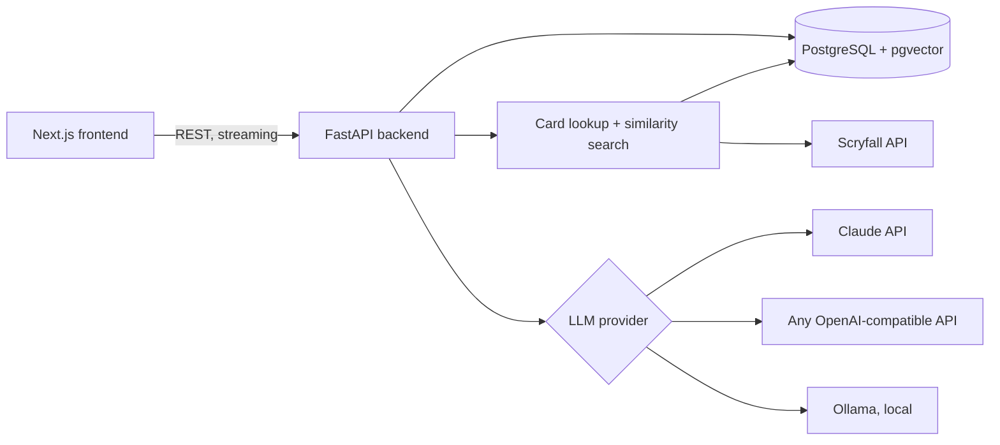

# MTG Chicken Soup

An AI deck-building assistant for Magic: The Gathering. Tell it the commander or format you want to play, or paste a decklist, and it suggests cards, explains why they belong, and points out what the deck is missing: ramp, card draw, removal, win conditions.

The point of the project is to make an LLM useful in a domain where it would otherwise get things confidently wrong. Answers are grounded in real card data, so the assistant recommends cards that exist, with the right rules text.

> **Demo:** a short video is coming. The app was previously deployed on Railway and is currently offline.

## What it does

- **Build a deck** around a commander, or for any constructed format (Standard, Pioneer, Modern, Legacy, Vintage, Pauper and others), and for Draft and Sealed.
- **Analyse a deck** you paste in, MTGO or Moxfield format, and get specific suggestions for cuts and additions.
- **Ask rules and strategy questions** in a general chat.
- **Save, edit, copy and share decks**, and import or export them as CSV. An "Extract & Save Deck" step turns a conversation into a structured decklist, sorted by card type.
- **Sign in** with Google or email and password, with a profile and avatar.
- Works on mobile.

## How it avoids made-up cards

LLMs are good at deck strategy and bad at remembering exact card text. Each request goes through two grounding steps before the model answers:

1. **Card lookup.** Card names in the message are matched against Scryfall's catalogue, including partial and ambiguous names (asking about "Ghalta" returns every matching card), and the real oracle text is added to the prompt.
2. **Similarity search.** The request is embedded and matched against every Commander-legal card in PostgreSQL with pgvector (cosine distance), so the model sees relevant cards it was not asked about by name. The number of cards retrieved scales with the request.

On top of that, the system prompt adapts to the format the conversation is about, so Commander advice follows Commander rules and limited advice follows draft logic.

## Architecture



- **Frontend:** Next.js 14, React, TypeScript, Tailwind CSS, NextAuth (Google OAuth).
- **Backend:** FastAPI, async SQLAlchemy, Alembic, Pydantic v2.
- **Database:** PostgreSQL 16 with pgvector; stores users, decks, conversations and card embeddings.
- **LLM providers:** chosen by configuration, in this order of precedence: Ollama (local), any OpenAI-compatible provider (GitHub Models, Groq, Cerebras, OpenRouter), then the Claude API. Responses stream to the browser.
- **Embeddings:** OpenAI `text-embedding-3-small` by default, or `nomic-embed-text` through Ollama at no cost.
- Everything runs with Docker Compose.

## Running it locally

You need Docker.

```bash
cp .env.example .env     # then fill in the values you need
make up                  # Postgres, backend on :8000, frontend on :3000
```

Set at least one LLM provider in `.env`:

| To use | Set |
| --- | --- |
| Claude | `ANTHROPIC_API_KEY` |
| A free OpenAI-compatible provider | `FREE_API_KEY`, `FREE_API_BASE_URL`, `FREE_MODEL` |
| A local model | `OLLAMA_MODEL`, then `make up-local` and `make pull-models` |

Then build the card data and embeddings once:

```bash
make fetch-scryfall      # Commander-legal cards from Scryfall's bulk export
make embed-cards         # embed every card into pgvector
```

Open http://localhost:3000.

## Data and fine-tuning pipeline

The repo also includes a pipeline to fine-tune an open model on Commander data. It is built but has not been run yet.

1. `make fetch-scryfall`: download and clean Scryfall's card data.
2. `make fetch-edhrec`: collect recommended cards and synergy scores for the top ~200 commanders from EDHREC (cached locally).
3. `make build-dataset`: generate instruction/answer pairs covering strategy, card recommendations, full deck builds and deck improvements.
4. `make train`: QLoRA fine-tuning of Qwen2.5-7B-Instruct (4-bit NF4, LoRA rank 32 on all projection layers), sized for a 16 GB GPU. Hyperparameters live in `backend/configs/training_config.yaml`.
5. `make merge-lora`: merge the adapter into a standalone model and point `MODEL_PATH` at it.

The open question it is set up to answer: does fine-tuning beat retrieval plus good prompts for this task?

## Project layout

```
backend/
  app/
    api/        REST endpoints: decks, chat, users
    ml/
      inference.py   provider selection, format-specific prompts, streaming
      rag.py         card lookup and pgvector search
      data/          Scryfall and EDHREC fetchers, dataset builder, embeddings
      training/      QLoRA fine-tuning and LoRA merge
    models/     SQLAlchemy tables
    schemas/    Pydantic contracts
  configs/      training configuration
frontend/
  app/          pages: build, analyze, decks, help, profile
  components/   chat interface, deck cards, navigation
```

## Next

- Tests (pytest, React Testing Library) and a GitHub Actions workflow
- Card image previews on hover
- Export to Moxfield and MTGO formats
- Win-rate and pick-order data for limited formats
- Run the fine-tuning and compare it against retrieval

## Built by

[Laura Rossi](https://www.linkedin.com/in/laura-agustina-rossi/), as a personal project.
